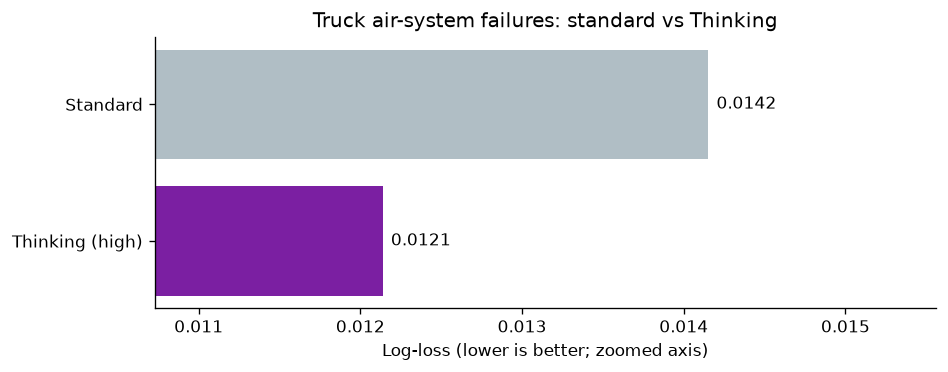
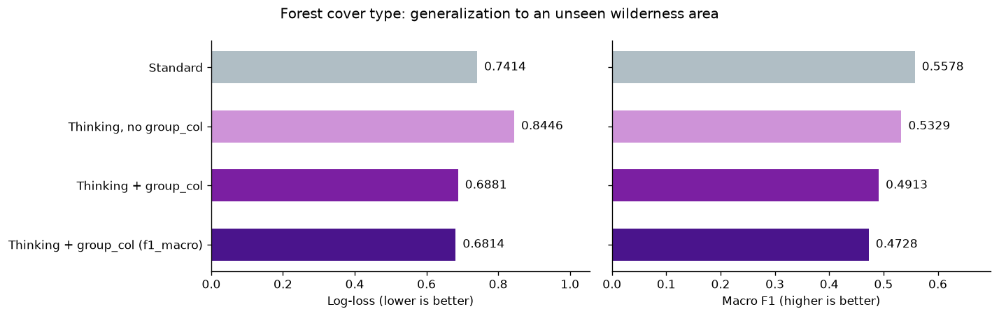

{/* cookbook-meta:start process_markdown.py */}
<div className="cookbook-meta">
{/* cookbook-authors:start process_markdown.py */}
<div className="cookbook-authors">
  <div className="cookbook-author-bar">
    <span className="cookbook-author-by">By</span>
    <span className="cookbook-author-list"><span className="cookbook-author-entry"><span className="cookbook-author-name">Prior Labs</span><span className="cookbook-author-links"><a href="https://www.linkedin.com/company/prior-labs" className="cookbook-author-icon-link" aria-label="LinkedIn" target="_blank" rel="noopener noreferrer"><svg className="cookbook-author-icon" viewBox="0 0 24 24" fill="currentColor" aria-hidden="true"><path d="M20.447 20.452h-3.554v-5.569c0-1.328-.027-3.037-1.852-3.037-1.853 0-2.136 1.445-2.136 2.939v5.667H9.351V9h3.414v1.561h.046c.477-.9 1.637-1.85 3.37-1.85 3.601 0 4.267 2.37 4.267 5.455v6.286zM5.337 7.433a2.062 2.062 0 1 1 0-4.124 2.062 2.062 0 0 1 0 4.124zM7.119 20.452H3.555V9h3.564v11.452zM22.225 0H1.771C.792 0 0 .774 0 1.729v20.542C0 23.227.792 24 1.771 24h20.451C23.2 24 24 23.227 24 22.271V1.729C24 .774 23.2 0 22.222 0h.003z"/></svg></a><a href="https://twitter.com/prior_labs" className="cookbook-author-icon-link" aria-label="X" target="_blank" rel="noopener noreferrer"><svg className="cookbook-author-icon" viewBox="0 0 24 24" fill="currentColor" aria-hidden="true"><path d="M18.244 2.25h3.308l-7.227 8.26 8.502 11.24H16.17l-5.214-6.817L4.99 21.75H1.68l7.73-8.835L1.254 2.25H8.08l4.713 6.231zm-1.161 17.52h1.833L7.084 4.126H5.117z"/></svg></a></span></span></span>
  </div>
</div>
{/* cookbook-authors:end process_markdown.py */}
{/* cookbook-colab:start process_markdown.py */}
<div className="cookbook-colab">
  <a href="https://colab.research.google.com/github/PriorLabs/tabpfn-cookbook/blob/main/notebooks/experiment_with_thinking_mode.ipynb" className="cookbook-colab-button" target="_blank" rel="noopener noreferrer">
    <svg className="cookbook-colab-icon" viewBox="0 0 24 24" aria-hidden="true" focusable="false"><path fill="#F9AB00" d="M16.9414 4.9757a7.033 7.033 0 0 0-4.9308 2.0646 7.033 7.033 0 0 0-.1232 9.8068l2.395-2.395a3.6455 3.6455 0 0 1 5.1497-5.1478l2.397-2.3989a7.033 7.033 0 0 0-4.8877-1.9297zM7.07 4.9855a7.033 7.033 0 0 0-4.8878 1.9316l2.3911 2.3911a3.6434 3.6434 0 0 1 5.0227.1271l1.7341-2.9737-.0997-.0802A7.033 7.033 0 0 0 7.07 4.9855zm15.0093 2.1721l-2.3892 2.3911a3.6455 3.6455 0 0 1-5.1497 5.1497l-2.4067 2.4068a7.0362 7.0362 0 0 0 9.9456-9.9476zM1.932 7.1674a7.033 7.033 0 0 0-.002 9.6816l2.397-2.397a3.6434 3.6434 0 0 1-.004-4.8916zm7.664 7.4235c-1.38 1.3816-3.5863 1.411-5.0168.1134l-2.397 2.395c2.4693 2.3328 6.263 2.5753 9.0072.5455l.1368-.1115z"/></svg>
    <span className="cookbook-colab-label">Open in Colab</span>
  </a>
</div>
{/* cookbook-colab:end process_markdown.py */}
</div>
{/* cookbook-meta:end process_markdown.py */}
Compare standard TabPFN 3.5 with Thinking for predicting truck air-system failures,
then predict forest cover in a wilderness area the model has never seen, using
`group_col` so Thinking optimizes for unseen groups.

## Setup

Install the client and dependencies (the current Thinking mode and `group_col` require `tabpfn-client` 0.7.1+).
In Colab, add `TABPFN_TOKEN` to Secrets; elsewhere, use your usual client authentication.

```python
%pip install -q --upgrade tabpfn-client==0.7.1 pandas==2.3.3 numpy==2.5.3 scikit-learn==1.9.0 matplotlib==3.11.2 pyarrow==25.0.1 huggingface-hub==1.31.0
```

```python
import os

try:
    from google.colab import userdata
except ImportError:
    pass
else:
    os.environ["TABPFN_TOKEN"] = userdata.get("TABPFN_TOKEN")
```

```python
import json
import time
from pathlib import Path

import matplotlib.pyplot as plt
import numpy as np
import pandas as pd
from huggingface_hub import hf_hub_download
from IPython.display import display
from sklearn.datasets import fetch_openml
from sklearn.metrics import f1_score, log_loss
from sklearn.model_selection import train_test_split
from sklearn.preprocessing import LabelEncoder, OrdinalEncoder
from tabpfn_client import TabPFNClassifier
from tabpfn_client.api_models import ModelVersion

plt.rcParams.update({"figure.dpi": 120, "axes.spines.top": False,
                     "axes.spines.right": False})
```

## Choose the objective

Enable Thinking with `thinking_mode=True` (effort `"medium"`) or pick an effort level
explicitly with `thinking_effort`, from fastest to most thorough: `"micro"`, `"mini"`,
`"low"`, `"medium"`, `"high"`, `"xhigh"`, `"max"`. We use `"high"` here. Set
`thinking_metric` to match your task. Both examples below optimise log-loss for
calibrated class probabilities, and we report macro F1 alongside. See the
[Thinking mode guide](https://docs.priorlabs.ai/capabilities/thinking-mode)
for supported settings. Thinking runs an optimization over the training set at fit time, so fitting takes
minutes rather than seconds and grows with the number of rows and features. In this
notebook the fits take roughly 20 minutes on the first dataset and 3 to 10 minutes
on the second; prediction time is unchanged. The effort levels set a compute
budget, and on these datasets lower levels converge to the same solution.

We use TabPFN 3.5 throughout. The helper reports log-loss, macro F1 and elapsed
time, including fitting, prediction, and API overhead.

```python
def evaluate(model, X_train, X_test, y_train, y_test):
    started = time.perf_counter()
    model.fit(X_train, y_train)
    probability = np.asarray(model.predict_proba(X_test), dtype=float)
    assert np.isfinite(probability).all()
    assert (probability >= 0).all()
    assert np.allclose(probability.sum(axis=1), 1, atol=1e-5)
    # Normalize small floating-point rounding differences from the API.
    probability /= probability.sum(axis=1, keepdims=True)
    prediction = model.classes_[probability.argmax(axis=1)]
    return {"Log-loss": log_loss(y_test, probability, labels=model.classes_),
            "Macro F1": f1_score(y_test, prediction, average="macro"),
            "Seconds": time.perf_counter() - started}
```

## Scania trucks: air pressure system failures

Predict whether a truck's air pressure system (APS) caused a breakdown from 170
anonymized sensor readings ([UCI APS Failure at Scania Trucks](https://doi.org/10.24432/C51S51),
CC BY 4.0). Failures are rare, about 1.7% of trucks, so we optimise log-loss for
calibrated failure probabilities and report macro F1 alongside. Both models use the same stratified 75/25 split.
Lower log-loss is better. The high-effort fit on 57,000 rows and 170 features takes
about 20 minutes; the standard fit takes seconds.

```python
aps = fetch_openml(data_id=41138, as_frame=True, parser="auto")  # APS Failure at Scania Trucks
X_aps = aps.data.apply(pd.to_numeric, errors="coerce")
y_aps = LabelEncoder().fit_transform(aps.target.astype(str))
Xtr_aps, Xte_aps, ytr_aps, yte_aps = train_test_split(
    X_aps, y_aps, test_size=0.25, random_state=0, stratify=y_aps,
)
print(f"{len(Xtr_aps):,} training trucks; {len(Xte_aps):,} held-out trucks; "
      f"{X_aps.shape[1]} features; {y_aps.mean():.1%} failures")
```

```console
57,000 training trucks; 19,000 held-out trucks; 170 features; 1.8% failures
```

```python
aps_rows = []
for name, settings in [
    ("Standard", {}),
    ("Thinking (high)", {"thinking_effort": "high", "thinking_metric": "log_loss"}),
]:
    model = TabPFNClassifier.create_default_for_version(ModelVersion.V3_5, **settings)
    result = evaluate(model, Xtr_aps, Xte_aps, ytr_aps, yte_aps)
    aps_rows.append({"Model": name, **result})
aps_results = pd.DataFrame(aps_rows).set_index("Model")
display(aps_results.round(4))
```

```console
                 Log-loss  Macro F1    Seconds
Model
Standard           0.0142    0.9366    38.5919
Thinking (high)    0.0121    0.9450  1260.8628
```

```python
fig, ax = plt.subplots(figsize=(8, 3.2))
scores = aps_results["Log-loss"]
bars = ax.barh(scores.index, scores, color=["#b0bec5", "#7B1FA2"])
padding = max((scores.max() - scores.min()) * 0.7, 0.001)
ax.set_xlim(max(0, scores.min() - padding), min(1, scores.max() + padding))
ax.bar_label(bars, fmt="%.4f", padding=5)
ax.set(xlabel="Log-loss (lower is better; zoomed axis)",
       title="Truck air-system failures: standard vs Thinking")
ax.invert_yaxis()
fig.tight_layout()
plt.show()
```



Thinking changes log-loss from **0.0142 to 0.0121** on this split, 15% lower, and
macro F1 from 0.9366 to 0.9450. The gain comes from the fit-time optimization,
which is why fitting took about 20 minutes instead of seconds.

## Forest cover type: use `group_col` for unseen regions

The [UCI Covertype dataset](https://doi.org/10.24432/C50K5N) describes 30 m
forest cells in the Roosevelt National Forest with cartographic features such as
elevation, slope and soil type. The target is the dominant tree species.

We use the [BeyondArena](https://huggingface.co/datasets/TabArena/BeyondArena)
version, which keeps three cover types and three wilderness areas and provides
splits that hold out entire wilderness areas. Rows from the same area share
climate and terrain, so this is grouped data: a model that generalizes to a new
area is more useful than one that interpolates within the areas it was trained on.
The target is not constant within an area; every area contains all three cover
types, so predictions and scores stay at the row level. The group only decides
which rows must be held out together.
Credit: Blackard (1998), CC BY 4.0.

```python
def download_covertype_file(filename):
    return hf_hub_download(
        "TabArena/BeyondArena",
        f"covertype/019d7391-8e33-757b-b38a-79ec188fa001/{filename}",
        repo_type="dataset", revision="88059a3f02ec4abb6ec24bbe0d1c0b7eed31485d",
    )

forest = pd.read_parquet(download_covertype_file("dataset.parquet"))
published_splits = json.loads(Path(download_covertype_file(
    "experiment_metadata.predictive-ml-splits-mold-v1.json"
)).read_text())["splits"]
# First fold of the published grouped split: two areas train, one area tests.
forest_train_idx, forest_test_idx = published_splits["0"]["0"]
print(f"{len(forest):,} cells, {forest.Wilderness_Area.nunique()} wilderness areas, "
      f"{forest.Cover_Type.nunique()} cover types")
```

```console
512,625 cells, 3 wilderness areas, 3 cover types
```

### Evaluate on an unseen wilderness area

The published fold trains on two wilderness areas and tests on the third. A random
row split would leak: neighbouring cells from the same area would land on both
sides, and the score would reward memorizing each area's terrain rather than
generalizing to a new one. The full fold is large, so we take a stratified sample
of 50,000 training cells and 20,000 test cells, keeping the areas disjoint.

```python
forest_train = forest.iloc[forest_train_idx]
forest_test = forest.iloc[forest_test_idx]
forest_train, _ = train_test_split(forest_train, train_size=50_000, random_state=0,
                                   stratify=forest_train.Cover_Type)
forest_test, _ = train_test_split(forest_test, train_size=20_000, random_state=0,
                                  stratify=forest_test.Cover_Type)
train_areas = set(forest_train.Wilderness_Area)
test_areas = set(forest_test.Wilderness_Area)
assert train_areas.isdisjoint(test_areas)
display(pd.DataFrame({
    "Split": ["Train", "Test"],
    "Rows": [len(forest_train), len(forest_test)],
    "Wilderness areas": [", ".join(sorted(train_areas)), ", ".join(sorted(test_areas))],
}).set_index("Split"))
```

```console
        Rows                              Wilderness areas
Split
Train  50000  Neota Wilderness Area, Rawah Wilderness Area
Test   20000                 Comanche Peak Wilderness Area
```

### Pass the group column

For grouped data, use Thinking with `group_col="Wilderness_Area"` and keep that
column in both training and prediction DataFrames. Thinking uses the column for
its own fit-time validation: rows of one area are never split between its internal
training and validation sets, so it optimizes for unseen areas instead of unseen
rows. That internal validation is separate from the outer holdout above, which
Thinking never sees. We compare four models on the
same held-out area: standard TabPFN, Thinking without the group column, Thinking
with it, and Thinking with it optimising macro F1 instead of log-loss, to show how
the choice of `thinking_metric` changes what improves. Soil descriptors are ordinal-encoded; the wilderness area is
only used as the group column, never as a feature. Expect about 10 minutes for
Thinking without the group column and 3 minutes for each grouped fit on 50,000 rows.

```python
GROUP = "Wilderness_Area"
soil_columns = ["Soil_Type", "Soil_ClimaticZone", "Soil_GeologicZone"]
soil_encoder = OrdinalEncoder(handle_unknown="use_encoded_value", unknown_value=-1)
soil_encoder.fit(forest_train[soil_columns].astype(str))

def features(frame):
    X = frame.drop(columns="Cover_Type").copy()
    X[soil_columns] = soil_encoder.transform(X[soil_columns].astype(str))
    X[GROUP] = X[GROUP].astype(str)
    return X

X_train, X_test = features(forest_train), features(forest_test)
encoder = LabelEncoder().fit(forest_train["Cover_Type"].astype(str))
y_train = encoder.transform(forest_train["Cover_Type"].astype(str))
y_test = encoder.transform(forest_test["Cover_Type"].astype(str))

forest_rows = []
# group_col tells Thinking which rows belong together, so its internal validation
# holds out whole wilderness areas. Without it, Thinking validates on random rows
# from the training areas, which leaks terrain across the split.
models = [
    ("Standard", TabPFNClassifier.create_default_for_version(ModelVersion.V3_5)),
    ("Thinking, no group_col", TabPFNClassifier.create_default_for_version(
        ModelVersion.V3_5, thinking_effort="high", thinking_metric="log_loss")),
    ("Thinking + group_col", TabPFNClassifier.create_default_for_version(
        ModelVersion.V3_5, thinking_effort="high", thinking_metric="log_loss",
        group_col=GROUP)),
    ("Thinking + group_col (f1_macro)", TabPFNClassifier.create_default_for_version(
        ModelVersion.V3_5, thinking_effort="high", thinking_metric="f1_macro",
        group_col=GROUP)),
]
for name, model in models:
    # Only grouped Thinking receives the wilderness area column.
    Xtr = X_train if model.group_col else X_train.drop(columns=GROUP)
    Xte = X_test if model.group_col else X_test.drop(columns=GROUP)
    result = evaluate(model, Xtr, Xte, y_train, y_test)
    forest_rows.append({"Model": name, **result})
    print(f"{name}: log-loss {result['Log-loss']:.4f}, macro F1 {result['Macro F1']:.4f}")

forest_results = pd.DataFrame(forest_rows).set_index("Model")
display(forest_results.round(4))
```

```console
Standard: log-loss 0.7414, macro F1 0.5578
Thinking, no group_col: log-loss 0.8446, macro F1 0.5329
Thinking + group_col: log-loss 0.6881, macro F1 0.4913
Thinking + group_col (f1_macro): log-loss 0.6814, macro F1 0.4728
                                 Log-loss  Macro F1   Seconds
Model
Standard                           0.7414    0.5578   15.4947
Thinking, no group_col             0.8446    0.5329  588.5521
Thinking + group_col               0.6881    0.4913  167.6216
Thinking + group_col (f1_macro)    0.6814    0.4728  168.3973
```

### Results on the unseen area

Left: log-loss, which the first three Thinking fits optimise. Right: macro F1,
which the last fit optimises.

```python
colors = ["#b0bec5", "#ce93d8", "#7B1FA2", "#4A148C"]
fig, axes = plt.subplots(1, 2, figsize=(12, 3.8), sharey=True)
for ax, metric, fmt in zip(axes, ["Log-loss", "Macro F1"], ["%.4f", "%.4f"]):
    scores = forest_results[metric]
    bars = ax.barh(scores.index, scores, color=colors, height=0.55)
    ax.bar_label(bars, fmt=fmt, padding=6)
    ax.set_xlim(0, scores.max() * 1.25)
    ax.set_xlabel(f"{metric} ({'lower' if metric == 'Log-loss' else 'higher'} is better)")
axes[0].invert_yaxis()
fig.suptitle("Forest cover type: generalization to an unseen wilderness area")
fig.tight_layout()
plt.show()
```



Thinking with `group_col` changes log-loss from **0.7414 to 0.6881** on the unseen
area, 7% lower. Thinking without the group column is worse than standard TabPFN
(**0.8446**): it optimized for the two training areas and generalized worse to the
third. Macro F1 moves the other way for every Thinking fit, and optimizing
`f1_macro` directly does not recover it (0.4728): the calibrated probabilities
transfer to the new area, but the hard labels for the rare Krummholz class do
not. On grouped data, judge Thinking on the probability metric it optimizes,
and check label metrics on held-out groups before relying on them.

## Takeaways

- Set `thinking_metric` to match your task.
- For grouped data, use `group_col` and retain it at prediction time. Without it,
  Thinking can optimize for the groups it was trained on and generalize worse.
- Evaluate on held-out data; for grouped data, hold out whole groups.
